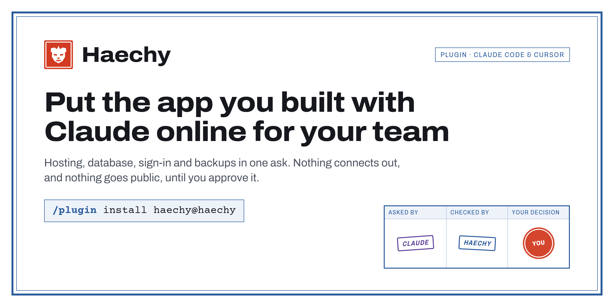
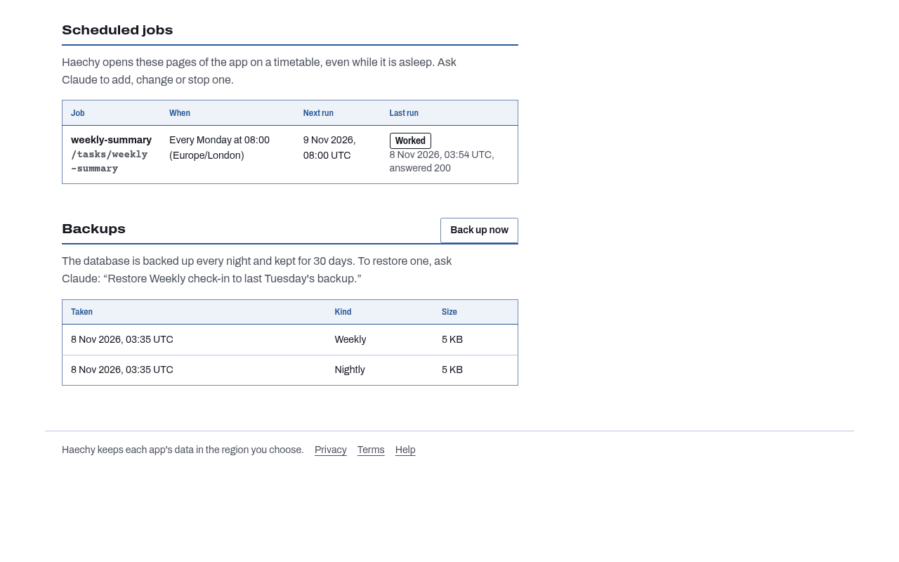
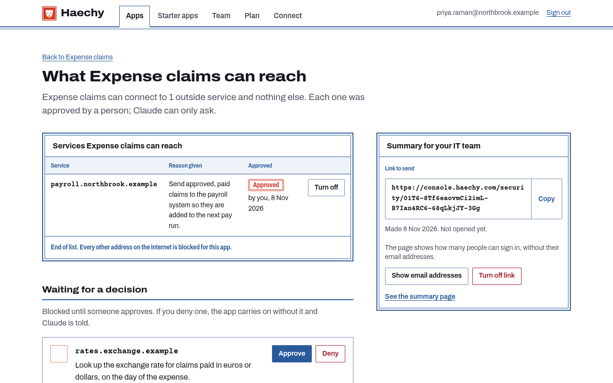
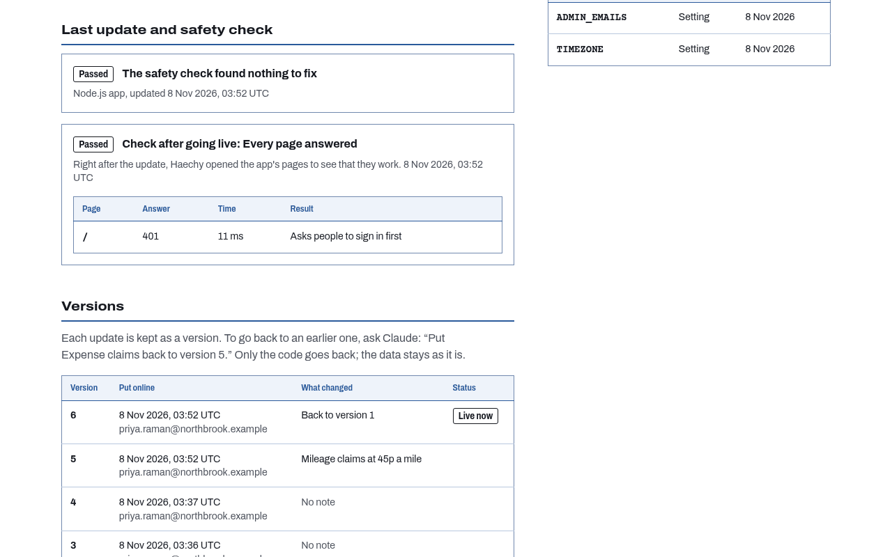
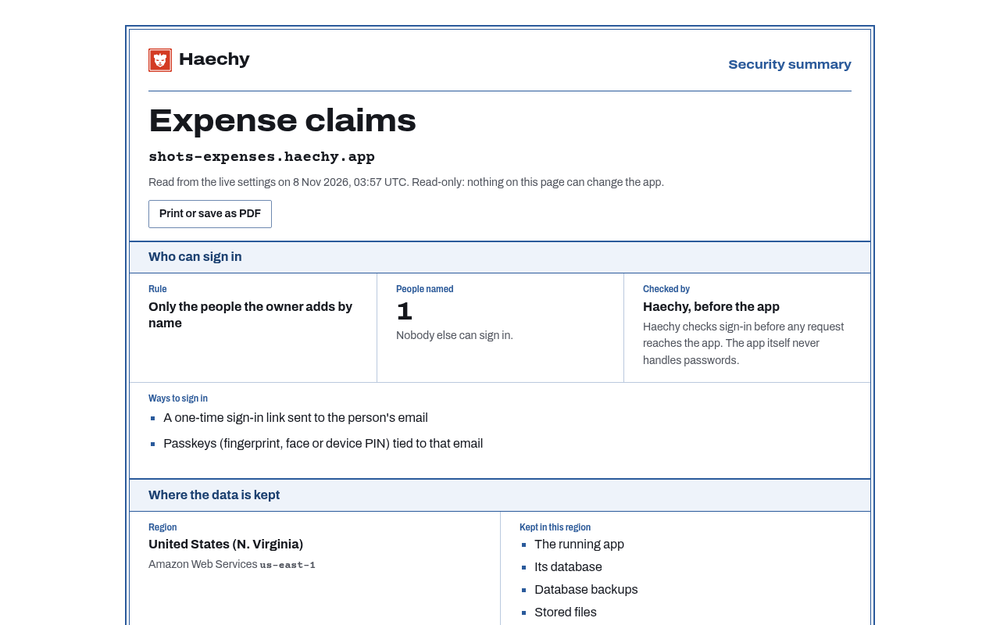
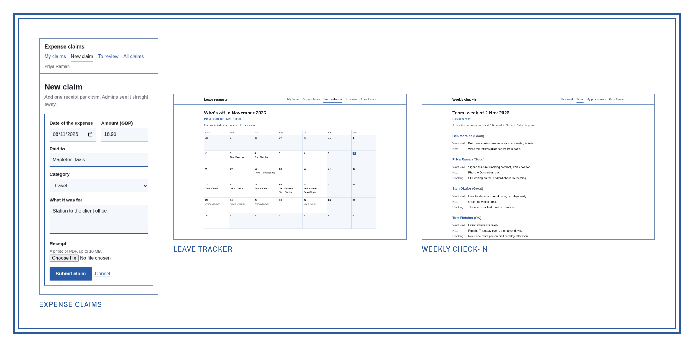
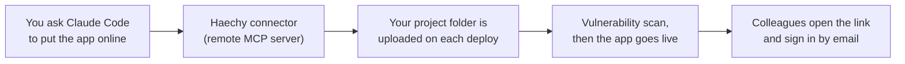

<div align="center">


# Haechy plugin for Claude Code: deploy and host the apps you build for your team

**Haechy lets Claude Code deploy and host the apps you build for your team at work: Postgres, colleague sign-in, nightly backups, approved outside access.**

[](LICENSE)
[](https://haechy.com/docs/connect/claude-code?utm_source=github&utm_medium=readme&utm_campaign=haechy-plugin)
[](https://haechy.com?utm_source=github&utm_medium=readme&utm_campaign=haechy-plugin)
[](https://haechy.com/pricing?utm_source=github&utm_medium=readme&utm_campaign=haechy-plugin)

[Install](#install-in-claude-code) · [Docs](https://haechy.com/docs?utm_source=github&utm_medium=readme&utm_campaign=haechy-plugin) · [Pricing](https://haechy.com/pricing?utm_source=github&utm_medium=readme&utm_campaign=haechy-plugin) · [Security](https://haechy.com/security)

</div>

<p align="center"></p>

You built a tracker, a form or a report with Claude Code, and now your colleagues need to use it. Ask Claude to put it online. Haechy gives the app its own web address, a database, and a sign-in for every colleague, with a backup every night. Your colleagues open a link and sign in with their email. They don't need Claude or a Haechy account, and you don't have to learn hosting.

The free plan covers 2 apps and 5 people, no card needed.

## Install in Claude Code

```
/plugin marketplace add dantarakan/haechy-plugin
/plugin install haechy@haechy
```

Then run `/mcp`, choose **haechy** and sign in. New accounts are created in the same window.

### Add the connector without the plugin

Prefer not to use a plugin? Add the connector directly:

```
claude mcp add --transport http --scope user haechy https://mcp.haechy.com/mcp/i/claude-directory
```

## What you can ask Claude to do

Once you're signed in, ask in plain words. Paste any of these into Claude Code from your app's folder:

```
Put this app online with Haechy and give me the link.
```

```
Let anna@yourcompany.com and ben@yourcompany.com sign in to this app.
```

```
Add a Postgres table for expense claims and keep it backed up every night.
```

```
Email the weekly summary every Monday at 8 to everyone who has access.
```

```
Put it back how it was yesterday.
```


## What you get

| What you get | What it means for you |
|---|---|
| **Its own web address** | Every app lives at `<name>.haechy.app` and starts private, so nobody sees it until you share it. |
| **A Postgres database** | Each app has its own Postgres 17 database, with a login that connects to that database only. |
| **Sign-in for colleagues** | They type their email and get a link that works once and expires after 15 minutes. No password, no Haechy account, no Claude account. After the first link their browser can offer a passkey. |
| **Nightly backups** | Your database is backed up every night. Free keeps 7 days, and you restore by asking Claude. |
| **File storage** | Uploads such as receipts and photos are kept privately, in your app's region. |
| **Scheduled jobs** | Weekly emails, nightly clean-ups and reminders run on a timer in your timezone, and you can run one now to test it. |
| **Live updates** | Boards and queues update on every colleague's screen without a refresh. |
| **Versions and rollback** | Every change that goes live is a numbered version. Rolling back puts the code back; your data stays as it is. |
| **Your own domain** | On paid plans, use `tools.yourcompany.com` instead of a haechy.app address. See [pricing](https://haechy.com/pricing?utm_source=github&utm_medium=readme&utm_campaign=haechy-plugin). |
| **Email from your app** | Reminders, approvals and weekly summaries go to the people who have access to the app. Free includes 300 a month. |
| **API keys kept out of the code** | API keys and passwords your app needs are stored as environment variables, and their values are never shown back. |
| **Four regions** | US, EU, UK or Australia. |
| **Node, Python or static files** | Haechy reads the stack from your project. |

<p align="center"></p>

## Made for apps your team uses at work

Colleagues sign in; outsiders don't. These are the controls that sit around your app, so you have something concrete to show your IT team.

- **Outside connections are blocked until you approve them.** An app has no route to the internet of its own. It can reach a host only if that host is on its approved list, and everything else is refused and logged. Claude can ask for a host, with a reason in plain words, and only the workspace owner or an admin can approve it. Claude can't approve its own request.
- **A vulnerability scan runs before every deploy**, on every plan. It is an automated check for known vulnerabilities and risky patterns. Keys or passwords in the code and uploaded `.env` files always stop the deploy, and so do a malicious package and a few other serious findings. Everything else comes back as a warning with the fix.
- **A review before an app goes public.** On paid plans, where an app can be made public, Haechy first lists the pages and endpoints that anyone on the internet could open without signing in, along with the outside services the app is approved to call. If it can't list them all, it says so. The app goes public only after you confirm that list in the Haechy console. Claude can't confirm it for you.
- **Your data stays in the region you pick.** The app, its database, backups and stored files stay there (see the questions below for what runs elsewhere).
- **A page you can send to IT.** Ask Claude to "Make a page I can send to IT". It's a read-only link showing who can sign in, the region, the approved connections and who approved them, the last check and the backups. It holds no keys or passwords, and no Haechy account is needed to open it. There is also a [page for IT teams](https://haechy.com/for-it?utm_source=github&utm_medium=readme&utm_campaign=haechy-plugin).

<p align="center"></p>

<p align="center"></p>

<p align="center"></p>

## Start from a starter app

Not sure what to build first? Ask Claude for one of these. Each is online in a minute or two, private to you at first, and you get the full code, so Claude can change it.

- **Leave tracker.** Requests, the yearly allowance left, approval and a who's-off calendar.
- **Expense claims.** A receipt photo, approve or reject with a note, mark paid, and a monthly CSV.
- **Weekly check-in.** Three questions and a mood once a week, with last week's answers emailed at 8 on Monday.
- **Bookings.** A shared log for a van, room or projector that refuses clashing bookings.
- **Approvals.** Send a request to one approver, who approves or denies it, with each step emailed.

<p align="center"></p>

See all of them on the [starter apps page](https://haechy.com/starter-apps?utm_source=github&utm_medium=readme&utm_campaign=haechy-plugin).

## Plans and regions

**Free:** 2 apps, up to 5 people who can sign in (you included), a 500 MB database, backups kept 7 days, one region, and every page needs sign-in. Apps sleep after 15 minutes idle and wake in a few seconds. No card.

**Pro and up** add public pages (with the review above), sign-in for anyone at your company's email domain, custom domains, faster scheduled jobs, longer backups and a region per app. See [pricing](https://haechy.com/pricing?utm_source=github&utm_medium=readme&utm_campaign=haechy-plugin) for the full list.

Regions: US (Northern Virginia), EU (Ireland), UK (London) and Australia (Sydney). More on [regions](https://haechy.com/regions?utm_source=github&utm_medium=readme&utm_campaign=haechy-plugin).

## How it works



1. You ask. Claude uses the Haechy connector's tools to create the app.
2. On deploy, your project folder is packed and sent to a single-use upload URL. Nothing is uploaded before that.
3. Haechy scans the code, puts the app live and checks that the home page loads.
4. Colleagues sign in with an emailed link. Later changes go the same way, each one a numbered version.

Nothing is installed on your computer: the plugin adds a remote connector and one skill. The only local step is the `tar` and `curl` upload Claude runs when you ask to deploy.

## Common questions

### Who is this for?
People at work who build their own tools with an AI assistant, such as a tracker, a form or a report, and need colleagues to use them.

### Do my colleagues need a Claude account?
No. They need their work email, and Haechy sends a one-time link that works once and expires after 15 minutes. There's no password and no Haechy account.

### Where is my data stored?
In the region you pick: US, EU, UK or Australia. The app, its database, backups, stored files and kept code versions stay there. Your account, sign-in and billing run on Haechy's control plane in the US. Some services we use to send email, verify phone numbers and take payments process data outside your chosen region. See the [sub-processors list](https://haechy.com/trust/sub-processors).

### What can my app connect to?
Nothing outside Haechy, until you approve it. Each approval is one host for one app, and you can turn it off at any time. The app's Connections page lists what it can reach, who approved it, the reason and any blocked attempts.

### What if a change goes wrong?
Ask Claude to put it back how it was yesterday. Rollback moves the code only. The database, stored files and settings stay as they are. To go back to older data, restore a nightly backup, which covers the database only (not stored files).

### Does Haechy work outside Claude Code?
Yes. Claude on the web, Claude desktop, Cursor, ChatGPT, Codex and VS Code with GitHub Copilot connect to the same server at `https://mcp.haechy.com/mcp`. Step-by-step guides are in [Connect Haechy](https://haechy.com/docs/connect/claude-code?utm_source=github&utm_medium=readme&utm_campaign=haechy-plugin).

### How does Haechy compare with other places to deploy from chat?
There's a side-by-side page for Hatchable, InstaPods, AppDeploy and Claude artifacts at [haechy.com/compare](https://haechy.com/compare?utm_source=github&utm_medium=readme&utm_campaign=haechy-plugin).

### Is this made by Anthropic?
No. Haechy is an independent product of DT Global Ventures Ltd. It is not made, sponsored or endorsed by Anthropic. Claude is a trademark of Anthropic, PBC.

## What this plugin does and sends

- **Adds one remote MCP server**, `https://mcp.haechy.com/mcp/i/claude-directory` (OAuth 2.1 with PKCE). Nothing else is installed
  or run on your computer: no hooks, no commands, no local server.
- **Includes one skill** (`skills/haechy`) with a technical build reference (`skills/haechy/references/build-guide.md`).
  When you ask Claude to put an app online, the skill has Claude call the Haechy connector's tools to create the app,
  deploy it, check the deploy and share it.
- **Uploads your project folder only when you ask to deploy.** In Claude Code, the connector returns a single-use
  upload URL on a Haechy host, and Claude runs one command from the app's folder that packs it with `tar`
  (leaving out `node_modules`, `.git`, `.env`, `__pycache__` and `.venv`) and sends it with `curl` to that URL.
  Outside Claude Code the files are passed to the connector directly.
- **Outside network access stays blocked** for your app until you approve each host yourself in the Haechy
  console. Claude can ask for access and cannot approve it.
- **No credentials are stored in the plugin.** API keys and passwords for your app are stored by Haechy as
  environment variables (`set_env_vars`) and their values are never shown back.

Privacy: https://haechy.com/legal/privacy · Security: https://haechy.com/security · Terms: https://haechy.com/legal/terms

## Docs and support

[Docs](https://haechy.com/docs?utm_source=github&utm_medium=readme&utm_campaign=haechy-plugin) · [Quickstart](https://haechy.com/docs/quickstart?utm_source=github&utm_medium=readme&utm_campaign=haechy-plugin) · Support: support@haechy.com

## License

MIT. See [LICENSE](LICENSE).

Haechy is an independent product of DT Global Ventures Ltd. It is not made, sponsored or endorsed by Anthropic.
Claude is a trademark of Anthropic, PBC.
